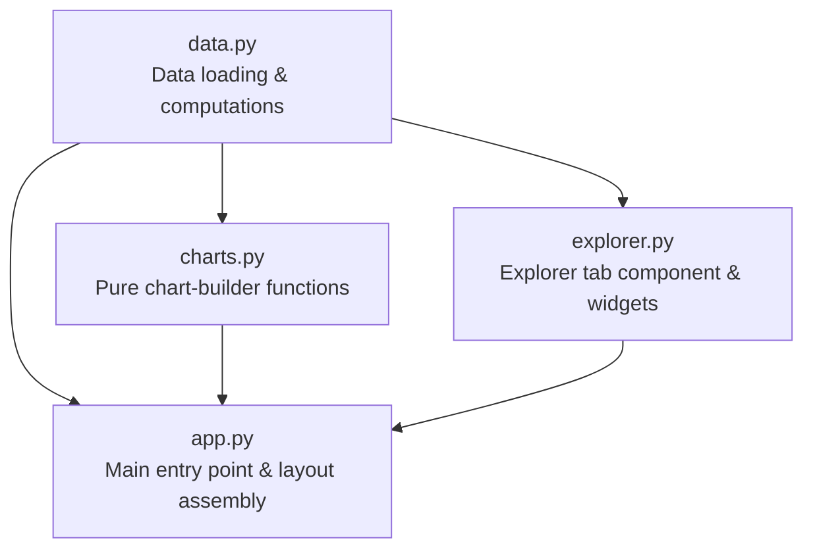
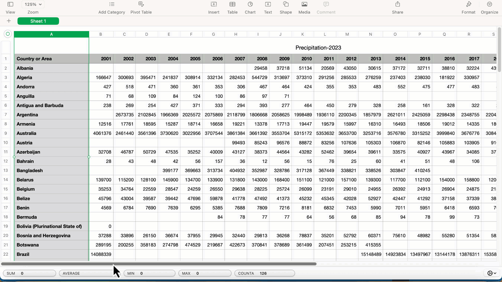

## Lab overview

Turn raw global environmental data into an interactive, multi-view web dashboard — without manual coding. Learn how to use Generative AI with Python, Panel (HoloViz), pandas, and Matplotlib to build an interactive precipitation data dashboard that explores historical annual precipitation reported to the United Nations for 125 countries and territories across a 23-year period (2001–2023). Along the way, you'll collaborate with IBM Bob step by step, gaining hands-on experience with AI-assisted software modularization, reactive UI widgets, statistical slope modeling, and tabbed dashboard development.

In this lab, you build a modular Python web application that parses historical UN data, calculates derived totals and climate trends using linear regression, provides an interactive data table with mutual-exclusion filtering, and renders multi-chart visual analytics in a polished tabbed interface.

***

### Learning objectives

After completing this lab, you should be able to:

- Build a multi-module interactive data dashboard using natural-language prompts in IBM Bob.
- Follow an AI-assisted development workflow to architect, scaffold, and refine modular Python applications.
- Calculate derived metrics and linear trend slopes using `pandas` and `numpy.polyfit`.
- Create reactive user interface widgets with HoloViz `Panel` and link them to dynamic data tables and Matplotlib plots.
- Implement mutual-exclusion UI logic and data filters to isolate positive and negative precipitation trends.

***

### About this lab

In this lab, you build an interactive data dashboard to explore historical annual precipitation data from the United Nations. The dataset covers 125 countries and territories between 2001 and 2023, measured in million cubic meters. The following chart shows the flow for this application: 

The application is structured into four clean modules (`data.py`, `charts.py`, `explorer.py`, and `app.py`) and features a two-tab interface:

- **Data Explorer Tab:**
  - An interactive, reactive data table with country search and numeric formatting.
  - Sorting and column-filtering controls with mutual-exclusion logic.
  - A toggle to filter the 61 countries exhibiting a negative precipitation trend.
  - A summary statistics sidebar surfacing key dataset findings and ranked top-5 totals.
- **Charts Tab:**
  - Top-5 multi-line chart comparing precipitation trends over time.
  - Top-5 percentage share pie chart with an aggregate "Other" slice.
  - A dynamic country selector dropdown.
  - A reactive single-country annual precipitation bar chart.
  - A reactive single-country trend scatter plot with an overlay of a red linear best-fit line.

Throughout the lab, you'll guide IBM Bob with clear instructions and specific requirements. IBM Bob will handle the coding and architecture, letting you focus on data insights and application requirements.

**Note:** Bob dynamically responds to prompts; therefore, your application may look slightly different from the screen images shown in this lab. Prompt Bob to make additional changes based on your preferences for features and styling.

***

### About the dataset

This lab uses historical annual precipitation data (`Precipitation-2023.csv`) published by the [United Nations Statistics Division - UNdata](https://data.un.org/). **Tip:** Right-click the link, and open the page in a new tab.

The columns in the dataset include:
- **Country or Area:** Name of the country or territory (125 total).
- **2001 to 2023:** Annual precipitation measurements in million cubic meters (values of `0.0` represent missing data).

***

### Estimated time

**60 minutes**

***

### Prerequisites

**Tip:** Right-click the following link, and open the pages in a new tab.

Complete the prerequisite tasks of [Get started with IBM Bob](../../ai-in-sports/get-started-with-ibm-bob.md)
