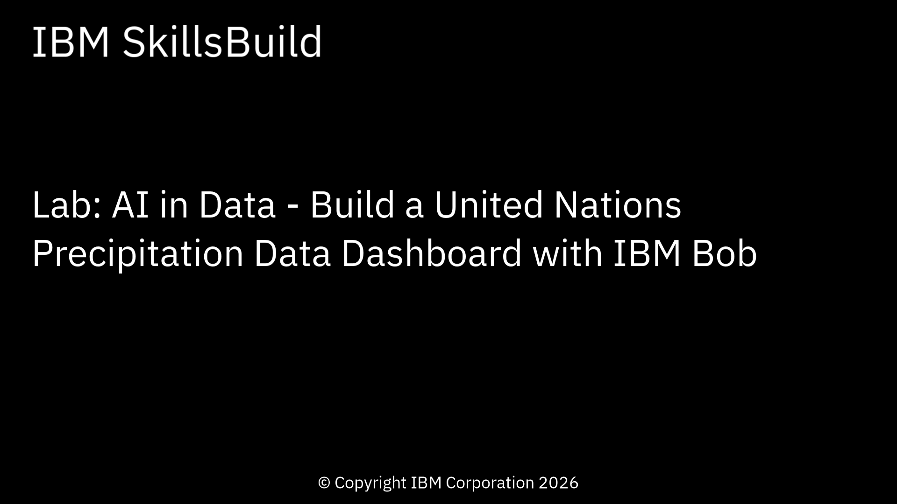

## Contents

- [Task 1: Set up the project](03_task-1-set-up-the-project.md)
- [Task 2: Create the shell application](04_task-2-create-the-shell-application.md)
- [Task 3: Build the data module](05_task-3-build-the-data-module.md)
- [Task 4: Build the Data Explorer tab](06_task-4-build-the-data-explorer-tab.md)
- [Task 5: Build the charts module](07_task-5-build-the-charts-module.md)
- [Task 6: Assemble the Charts tab](08_task-6-assemble-the-charts-tab.md)
- [Task 7: Apply final styling and polish](09_task-7-apply-final-styling-and-polish.md)
- [Summary](10_summary.md)
- [Additional resources](10_summary.md#additional-resources)

***

### Preview the tutorial

Watch the following video to see a preview of the steps in this tutorial.

**Note:** Some user interface elements in the video might look different from your IBM Bob environment.

**Tip:** Right-click the following thumbnail image, and open the video in a new tab.

