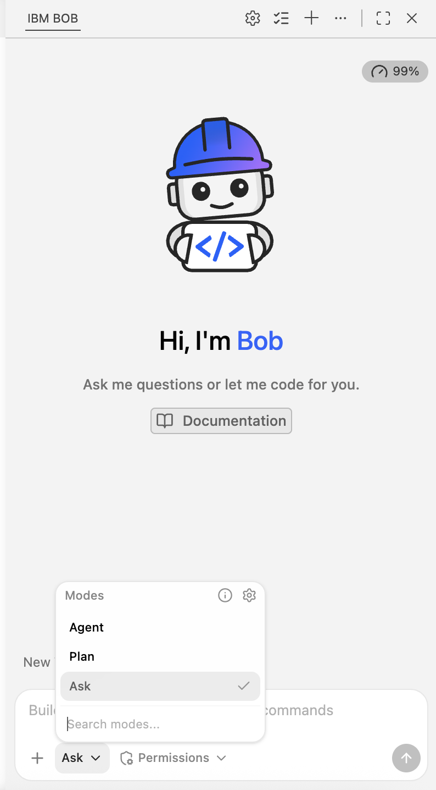
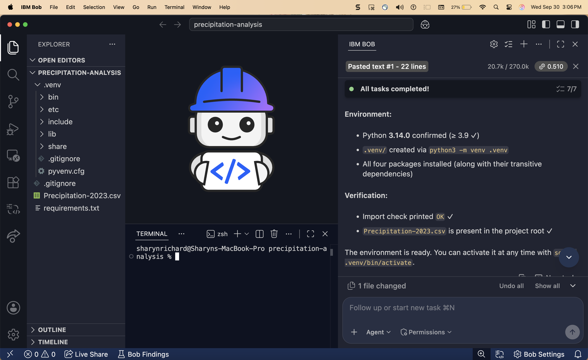

<a name="top"></a>

In this task, you will set up the project:

- Create a project folder and place the `Precipitation-2023.csv` data file in it.
- Verify and install the following core Python libraries:
  - **Python** - A versatile, high-level programming language used extensively in data science, web development, and AI.
  - **Panel (HoloViz)** - A high-level app and dashboarding framework for Python that turns data analysis into reactive web dashboards and multi-tab applications.
  - **pandas** - A foundational library for data manipulation and analysis, providing DataFrames for indexing, aggregating, and filtering tabular datasets.
  - **NumPy** - A fundamental package for scientific computing in Python, used in this lab for linear regression and polynomial fitting (`polyfit`).
  - **Matplotlib** - A comprehensive library for creating static, animated, and interactive visualizations in Python.

Don't worry if you don't have these packages installed yet — IBM Bob will help you check and install them in an isolated virtual environment!

### Task 1a: Set up the project folder and data

Follow these steps to create the lab directory and save the dataset:

1. In Bob, open the terminal window: click **Terminal > New Terminal**.
1. Choose a folder for the project, and `cd` into that folder.
1. Create a dedicated directory for your project:

   ```bash
   mkdir ai-in-data-precipitation
   cd ai-in-data-precipitation
   ```

1. Download <a href="Precipitation-2023.csv" target="_blank">Precipitation-2023.csv</a> from the GitHub repository, and store the file in the `ai-in-data-precipitation` folder. **Tip:** Right-click the link, and open the page in a new tab.

1. Open the project folder in IBM Bob:
   1. Click **File > Open Folder**.
   2. Navigate to the **ai-in-data-precipitation** folder.
   3. Click **Open**.

*Results:* The project folder `ai-in-data-precipitation` contains `Precipitation-2023.csv` at its root.

### Task 1b: Set up the environment

Follow these steps to install the required tools using IBM Bob:

1. In the Bob chat side panel, select **Agent** mode.

   

1. In the Bob chat panel, copy and paste the following prompt:

   ### What this prompt does
   Before you build the solution, you need a working Python environment with the correct libraries and folder structure. With this prompt, IBM Bob creates the project configuration files, installs the required dependencies into an isolated virtual environment, and confirms the source data file is in place.

   ### How it works
   Python's built-in `venv` module creates a project-local environment so dependencies do not conflict with other projects. Bob installs the libraries into that environment and runs an import test to prove all packages load cleanly before any application code is written.

   ```text
   I need help setting up a Python project to build an interactive precipitation data dashboard.

   Create the following in the current working directory:

   1. A `requirements.txt` file listing these four packages, one per line, with no pinned versions:
      panel
      pandas
      numpy
      matplotlib

   2. A `.gitignore` file that ignores the `.venv/` directory.

   Then run the following shell commands in order:
   - `python --version` — confirm Python 3.9 or higher is installed.
   - `python -m venv .venv` — create a virtual environment in the project root.
   - `source .venv/bin/activate` — activate the environment (macOS/Linux). On Windows use `.venv\Scripts\activate`.
   - `pip install -r requirements.txt` — install all dependencies.
   - `python -c "import pandas, numpy, matplotlib, panel; print('OK')"` — verify all packages import cleanly.

   Finally, confirm that `Precipitation-2023.csv` is present in the project root. This file is the data source for the entire project and must not be moved or renamed.

   Do not create any Python source files yet. This phase is complete when the verification command prints `OK` and `Precipitation-2023.csv` is confirmed present.
   ```

1. To confirm permission to complete the tasks, click **Approve once** when prompted by Bob, and follow the prompts.

### What Bob does

Bob completes the following tasks based on the prompt:

- Creates a `requirements.txt` file specifying `panel`, `pandas`, `numpy`, and `matplotlib`.
- Creates a `.gitignore` file configured to ignore the `.venv/` folder.
- Creates and activates a project-local virtual environment (`.venv`).
- Installs all dependencies and executes an import test to confirm they load cleanly.
- Verifies that `Precipitation-2023.csv` exists in the project root.

The following image shows the verified project setup:



[Back to the top](#top)
