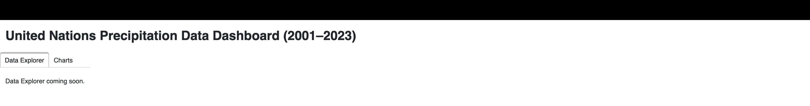

In this task, you create the main application entry point (`app.py`). It establishes the initial page structure with a main title and two tabs ("Data Explorer" and "Charts") containing placeholder content, establishing a runnable application shell for all subsequent modules.

Follow these steps to build the application shell:

1. Copy and paste the following prompt into Bob's chat panel:

   ### What this prompt does
   Before adding data or charts, you establish a runnable application frame. With this prompt, IBM Bob creates the main entry point that defines the page layout, tab structure, and the title that users will see every time the dashboard loads.

   ### How it works
   Panel's `pn.Tabs` component provides the two-tab shell, and calling `.servable()` on the top-level layout registers it with the Panel server so it can be served immediately in a browser. This gives you a live, working application skeleton from the very first run.

   ```text
   In this phase, create `app.py` in the project root. This is the shell of the dashboard — it should serve immediately and show the page structure, but the tabs will contain placeholder text for now. Content will be added in later phases.

   Build the file as follows:

   1. Import `panel as pn`.

   2. Call `pn.extension()` near the top of the file to initialise Panel.

   3. Create two placeholder tab contents:
      - A `pn.pane.Markdown` with the text "Data Explorer coming soon." for the Data Explorer tab.
      - A `pn.pane.Markdown` with the text "Charts coming soon." for the Charts tab.

   4. Build a `pn.Tabs` layout with two tabs:
      - ("Data Explorer", the Data Explorer placeholder)
      - ("Charts", the Charts placeholder)

   5. Wrap the `pn.Tabs` in a `pn.Column` containing:
      - A Markdown heading: "# United Nations Precipitation Data Dashboard (2001–2023)" as the first element
      - The `pn.Tabs` as the second element

   6. Call `.servable()` on the top-level `pn.Column`.

   After writing the file, check for syntax errors by running:
     python -c "import app"

   This should be complete silently with no errors.
   ```

1. To confirm permission to complete the tasks, click **Approve once** when prompted by Bob, and follow the prompts.

### What Bob does

Bob completes the following tasks based on the prompt:

- Imports `panel as pn` and initializes Panel with `pn.extension()`.
- Creates placeholder Markdown panes for both the Data Explorer and Charts views.
- Builds a `pn.Tabs` layout containing the two tab views.
- Assembles a top-level `pn.Column` with the main dashboard header and calls `.servable()`.
- Verifies that `import app` executes without errors.

### Explore the application

1. In the terminal window, start the Panel development server:

   ```bash
   panel serve app.py --show --autoreload
   ```

1. A browser window will open to the served dashboard URL (typically `http://localhost:5006/app`).

1. Explore the application shell:
   - Notice the main header: *United Nations Precipitation Data Dashboard (2001–2023)*.
   - Click between the **Data Explorer** and **Charts** tabs to verify that both placeholder messages appear.

The following image shows the running application shell:

<kbd></kbd>

[Back to the top](02_contents.md)
