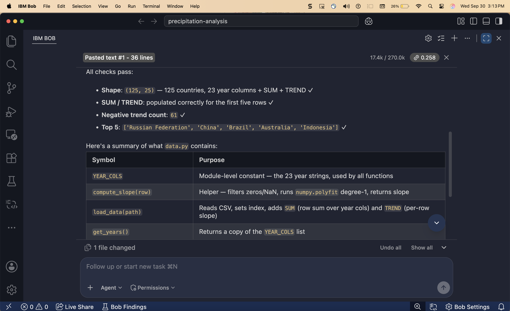

## Task 3: Build the data module

In this task, you prompt Bob to create `data.py` to centralize all data loading, row-wise aggregation, linear trend slope computation, and summary helper functions so that UI components never perform raw CSV parsing.

Follow these steps to build the data processing module:

1. Copy and paste the following prompt into Bob's chat panel:

   ### What this prompt does
   You need the raw CSV data loaded, enriched, and available to every other module before you can build the UI. With this prompt, IBM Bob creates the centralized data layer that all tabs and charts will import, so data processing logic lives in one place and is never duplicated.

   ### How it works
   pandas reads the CSV into a DataFrame and indexes it by country name. NumPy's `polyfit` function calculates a linear regression slope for each country's precipitation values over time, treating years with a value of `0.0` as missing data to keep the trend calculation accurate.

   ```text
   In this phase, create `data.py` in the project root.

   The data comes from `Precipitation-2023.csv`, which contains historical annual precipitation measurements 
   (in million cubic meters) reported to the United Nations. It has 125 rows — one per country or territory — 
   and 24 columns: "Country or Area" plus one column for each of these years: 2001, 2002, 2003, 2004, 2005, 
   2006, 2007, 2008, 2009, 2010, 2011, 2012, 2013, 2014, 2015, 2016, 2017, 2018, 2019, 2020, 2021, 2022, 2023.
   Values of 0.0 in the year columns represent missing data, not actual zero precipitation.

   `data.py` must contain the following:

   1. A function `load_data(path="Precipitation-2023.csv")` that:
      - Reads the CSV into a pandas DataFrame using `pandas.read_csv`.
      - Sets the "Country or Area" column as the DataFrame index and removes it from the data columns.
      - Computes a "SUM" column containing the row-wise total across all 23 year columns only (use 
        `df[year_cols].sum(axis=1)` so that derived columns added later are not included).
      - Computes a "TREND" column using a helper function called `compute_slope`. For each row, `compute_slope` should:
        - Filter the row to only include year columns where the value is greater than 0.0 (excluding missing data).
        - If fewer than 2 valid values remain, return `numpy.nan`.
        - Otherwise, call `numpy.polyfit` with the years cast to integers as x-values and the precipitation 
          values as y-values, using degree 1, and return the slope (the first element of the result).
      - Returns the fully enriched DataFrame.

   2. A function `get_years()` that returns this exact list of year column names as strings:
      ['2001','2002','2003','2004','2005','2006','2007','2008','2009','2010','2011','2012','2013','2014','2015',
      '2016','2017','2018','2019','2020','2021','2022','2023']

   3. A function `get_countries()` that calls `load_data()` and returns a sorted list of all country and territory 
   names from the DataFrame index.

   4. A function `get_negative_trend_countries()` that calls `load_data()` and returns a sorted list of country 
   names where the TREND value is less than 0.0.

   5. A function `get_top5_countries()` that calls `load_data()` and returns a list of the 5 country names with 
   the highest SUM values, ordered from highest to lowest.

   After writing the file, verify it works by running:
     python -c "
     import data
     df = data.load_data()
     print(df.shape)
     print(df[['SUM','TREND']].head())
     print('Negative trend count:', len(data.get_negative_trend_countries()))
     print('Top 5:', data.get_top5_countries())
     "

   The output should show a shape of (125, 25), SUM and TREND values for the first five countries, a negative trend 
   count of 61, and a top-5 list.
   ```

1. To confirm permission to complete the tasks, click **Approve once** when prompted by Bob, and follow the prompts.

### What Bob does

Bob creates `data.py` with the following functionality:

- `load_data()` loads `Precipitation-2023.csv`, indexes by `Country or Area`, calculates row-wise 23-year totals (`SUM`), and derives linear trend slopes (`TREND`) via `numpy.polyfit` while ignoring `0.0` missing data values.
- `get_years()` returns the 23 year column labels as an ordered list.
- `get_countries()` returns an alphabetical list of all 125 country and territory names.
- `get_negative_trend_countries()` returns all 61 countries exhibiting a negative slope (`TREND < 0.0`).
- `get_top5_countries()` identifies and ranks the top-5 countries by total 23-year volume (starting with Russian Federation).

### Verify the results

1. Check Bob's terminal output from the verification script. Confirm that:
   - The DataFrame shape is `(125, 25)` (23 year columns + `SUM` + `TREND`).
   - The negative trend count equals `61`.
   - The top-5 list outputs: `['Russian Federation', 'China', 'Brazil', 'Australia', 'Indonesia']`.

The following image shows the verified data module output:



[Back to the top](02_contents.md)
