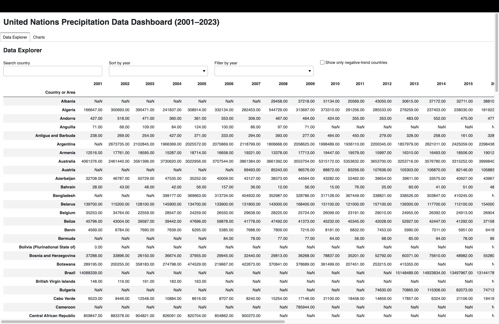

<a name="top"></a>

In this task, you build `explorer.py` to create the Data Explorer tab component. It features an interactive, reactive data table with country search, year-based sorting and filtering with mutual exclusion, negative-trend filtering, and a dataset statistics sidebar. You will then wire `explorer_tab` into `app.py`.

Follow these steps to create and integrate the Data Explorer tab:

1. Copy and paste the following prompt into Bob's chat panel:

   ### What this prompt does
   With the data module in place, you now build the first interactive tab that lets users browse and filter the full dataset. With this prompt, IBM Bob creates the content for the Data Explorer tab, complete with reactive search, sorting, column filtering, and a statistics sidebar, then wires it directly into the running application.

   ### How it works
   Panel's `pn.bind` function connects each widget to the data table so the display updates automatically whenever a user changes a filter or search value. Mutual-exclusion callbacks ensure the sort and filter dropdowns cannot conflict with each other, keeping the user interface predictable and consistent.

   ```text
   The previous phases created `app.py` and `data.py`. In this phase, build the Data Explorer tab and wire it into the app.

   This tab lets users interactively browse all 125 countries in a filterable data table, alongside a static statistics sidebar that surfaces key findings from the data analysis.

   Step 1 — Create `explorer.py` in the project root.

   `explorer.py` must build and expose a single Panel object called `explorer_tab` that represents the full content of the Data Explorer tab. Build it as follows:

   1. Import `panel as pn`, then import `data` from the local module.

   2. Load the data once at module level: `df = data.load_data()`.

   3. Define a function `data_table(country_search, sort_year, year_filter, negative_only)` inside `explorer.py`:
      - `country_search` is a string. Filter rows where the index (country name) contains this value (case-insensitive). Skip the filter if the string is empty.
      - `year_filter` is a string. If it is not empty, keep only that year column plus SUM and TREND in the displayed table; if empty, show all columns.
      - `negative_only` is a boolean. When True, filter the DataFrame to only include rows where TREND < 0.0.
      - `sort_year` is a string. If it is not empty, sort the resulting DataFrame by that year column in descending order.
      - Return a `pn.pane.DataFrame` pane showing the filtered/sorted DataFrame, with numeric columns formatted to 2 decimal places using the `float_format` parameter.

   4. Create a country search field using `pn.widgets.TextInput` with:
      - name set to "Search country"
      - value set to "" (empty by default)

   5. Create a sort by year dropdown using `pn.widgets.Select` with:
      - name set to "Sort by year"
      - options set to a list containing an empty string "" (meaning "no sort") followed by all year column names from `data.get_years()`
      - value set to "" (no sort by default)

   6. Create a year filter dropdown using `pn.widgets.Select` with:
      - name set to "Filter by year"
      - options set to a list containing an empty string "" (meaning "all years") followed by all year column names from `data.get_years()`
      - value set to "" (show all years by default)

   7. Wire up mutual exclusion between the two year dropdowns so that selecting a year in one disables the other:
      - Define a function `update_filter_disabled(sort_val)` that sets `year_filter_widget.disabled = (sort_val != "")`. Bind it to the sort-by-year widget using `pn.bind`.
      - Define a function `update_sort_disabled(filter_val)` that sets `sort_year_widget.disabled = (filter_val != "")`. Bind it to the year-filter widget using `pn.bind`.
      - Both functions must return `None` (they are side-effect-only watchers, not reactive components added to the layout).

   8. Create a filter checkbox using `pn.widgets.Checkbox` with:
      - name set to "Show only negative-trend countries"
      - value set to False

   9. Use `pn.bind` to wire `data_table` to all four widgets (country search, sort by year, year filter, and the checkbox) so the table re-renders whenever any widget changes.

   10. Build a statistics sidebar as a `pn.pane.Markdown` pane. Compute these values once at module level from `data.get_negative_trend_countries()` and `data.get_top5_countries()`, and format them into a Markdown string with these sections:
       - "## Dataset Summary"
       - "**Total countries:** 91"
       - "**Countries with negative precipitation trend:** {count}"
       - "## Top 5 Countries by Total Precipitation" followed by a numbered list of the 5 country names

   11. Assemble the tab content as a `pn.Column` containing:
       - A Markdown heading: "## Data Explorer"
       - A `pn.Row` with the country search field, the sort by year dropdown, the year filter dropdown, and the filter checkbox
       - A `pn.Row` with the reactive data table on the left and the statistics sidebar on the right

   12. Assign this `pn.Column` to a module-level variable called `explorer_tab`.

   Step 2 — Update `app.py` to use `explorer_tab`.

   Replace the "Data Explorer coming soon." placeholder in `app.py` with `explorer.explorer_tab`:
   1. Add `import explorer` to the imports in `app.py`.
   2. Replace the Data Explorer placeholder `pn.pane.Markdown` with `explorer.explorer_tab` in the `pn.Tabs` definition.

   After making both changes, verify by running:
     python -c "import app"

   This should be complete silently.
   ```

1. To confirm permission to complete the tasks, click **Approve once** when prompted by Bob, and follow the prompts.

### What Bob does

Bob completes the following tasks based on the prompt:

- Creates `explorer.py` with input widgets for search, sort, column filtering, and negative-trend filtering.
- Implements mutual-exclusion callbacks so choosing a sort year disables column filtering, and vice versa.
- Creates a reactive `pn.pane.DataFrame` linked to all controls via `pn.bind`.
- Assembles a static markdown statistics panel with dataset totals and top-5 rankings.
- Updates `app.py` to import `explorer` and embed `explorer.explorer_tab` into the first tab of `pn.Tabs`.

### Explore the application

1. Switch back to your browser (the autoreload server updates automatically).

1. Explore the **Data Explorer** tab:
   - Type a country name (such as `Chile` or `United`) into **Search country** to verify real-time filtering.
   - Select a year in **Sort by year** (e.g., `2005`) and observe that the table re-orders by that column and **Filter by year** becomes disabled. Clear the selection to re-enable both.
   - Select a year in **Filter by year** (e.g., `2008`) and observe that other annual columns hide while **Sort by year** is disabled.
   - Check **Show only negative-trend countries** to isolate the 61 countries with negative slope values.
   - Review the **Dataset Summary** and **Top 5 Countries by Total Precipitation** in the statistics sidebar.

The following image shows the interactive Data Explorer tab:

<kbd></kbd>

[Back to the top](#top)
