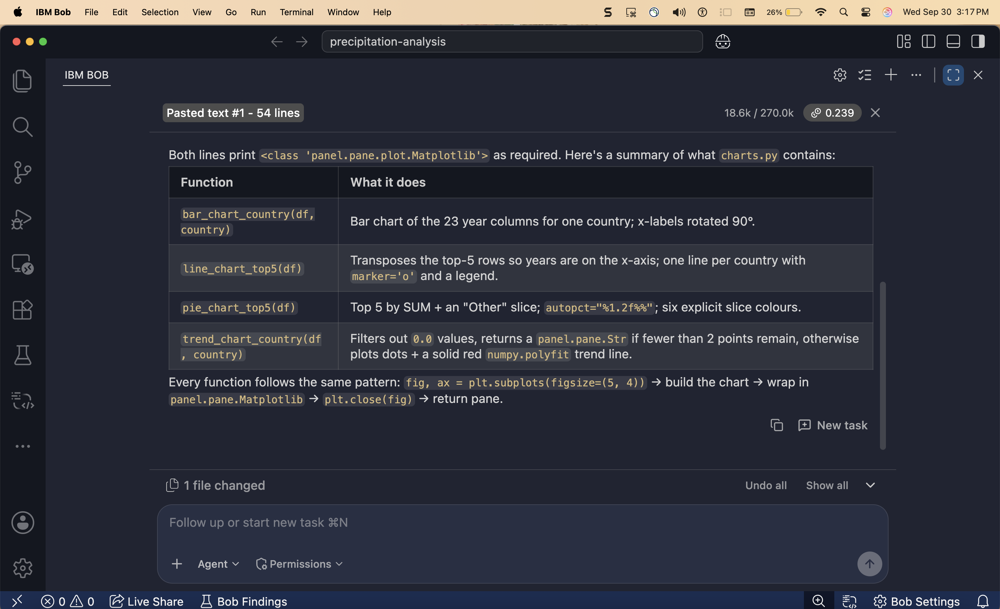

In this task, you prompt Bob to create `charts.py` containing pure chart-generating functions using Matplotlib and Panel. Each function creates an isolated, properly sized figure, wraps it in a `pn.pane.Matplotlib` object, and manages memory cleanly.

Follow these steps to build the charts module:

1. Copy and paste the following prompt into Bob's chat panel:

   ### What this prompt does
   The Data Explorer tab provides tables and filters, but charts reveal patterns that numbers alone can miss. With this prompt, IBM Bob builds a dedicated chart library of four pure functions — each producing a self-contained, properly sized visualization ready to be dropped into the Charts tab.

   ### How it works
   Matplotlib generates each figure in isolation, and Panel's `pn.pane.Matplotlib` wrapper makes each figure renderable inside the dashboard. Calling `plt.close(fig)` after each wrap prevents figures from accumulating in memory as users interact with country dropdowns and filters.

   ```text
   The previous phases created `app.py`, `data.py`, and `explorer.py`. In this phase, create `charts.py` in the project root.

   `charts.py` builds all four charts used in the dashboard. Each chart function must:
   - Create a new matplotlib figure using `fig, ax = plt.subplots(figsize=(5, 4))` so figures are fully isolated from each other and sized to fit side-by-side within the browser window without horizontal scrolling.
   - Wrap the figure in a `panel.pane.Matplotlib` object and return it.
   - Call `plt.close(fig)` after wrapping so figures do not accumulate in memory.

   Implement these four functions:

   1. `bar_chart_country(df, country)`
      - Looks up the row for the given country in the DataFrame.
      - Uses only the 23 year columns (not SUM or TREND).
      - Plots a bar chart showing annual precipitation for that country across all available years.
      - Sets the x-axis tick labels to the year names, rotated 90 degrees.
      - Title: "Precipitation of {country} (2001–2023)"
      - X-axis label: "Year"
      - Y-axis label: "Precipitation (million cubic meters)"

   2. `line_chart_top5(df)`
      - Finds the 5 countries with the highest total precipitation by sorting the SUM column in descending order and taking the first 5 rows.
      - Transposes the 23 year columns so that years are on the x-axis and each country is a separate line.
      - Plots each country as a line with circular markers (marker='o') and includes a legend.
      - Title: "Top 5 Countries by Total Precipitation"
      - X-axis label: "Year"
      - Y-axis label: "Precipitation (million cubic meters)"

   3. `pie_chart_top5(df)`
      - Builds a pandas Series from the SUM values of the top 5 countries (sorted by SUM descending).
      - Adds a sixth entry labelled "Other" whose value is the combined SUM of all remaining countries.
      - Plots a pie chart with percentage labels formatted to 2 decimal places (autopct="%1.2f%%").
      - Uses these slice colours in order: blue, green, red, turquoise, magenta, yellow.
      - Title: "Annual Precipitation Percentage"

   4. `trend_chart_country(df, country)`
      - Looks up the row for the given country in the DataFrame, using only the 23 year columns.
      - Filters out any 0.0 values (missing data).
      - If fewer than 2 valid data points remain, returns a `panel.pane.Str` pane with the message: "Not enough data to compute a trend for {country}."
      - Otherwise, fits a straight line through the valid data points using `numpy.polyfit` with the years as integers for the x-axis and degree 1.
      - Plots the valid data points as dots ('.') and the fitted line as a solid red line ('-').
      - Title: "Precipitation Trend for {country}"
      - X-axis label: "Year"
      - Y-axis label: "Precipitation (million cubic meters)"

   After writing the file, verify it works by running:
     python -c "
     import data, charts
     df = data.load_data()
     p = charts.bar_chart_country(df, 'Germany')
     print(type(p))
     p2 = charts.line_chart_top5(df)
     print(type(p2))
     "

   Both lines should print: <class 'panel.pane.plot.Matplotlib'>
   ```

1. To confirm permission to complete the tasks, click **Approve once** when prompted by Bob, and follow the prompts.

### What Bob does

Bob creates `charts.py` containing four charting functions:

- `bar_chart_country()`: Generates an annual bar chart for any selected country with rotated year ticks.
- `line_chart_top5()`: Plots 23-year comparative line trends with point markers and legends for the top 5 precipitation leaders.
- `pie_chart_top5()`: Calculates global percentage shares for the top 5 countries plus a combined "Other" slice with designated colors.
- `trend_chart_country()`: Plots valid non-zero data points and fits a regression line in red, returning an informative string pane when fewer than 2 valid points exist.
- Standardizes all plots with `figsize=(5, 4)` and memory cleanup via `plt.close(fig)`.

### Verify the results

1. Check the verification output in Bob's panel.
1. Confirm both test function calls return `<class 'panel.pane.plot.Matplotlib'>`.

The following image shows the verified chart module testing:



[Back to the top](02_contents.md)
