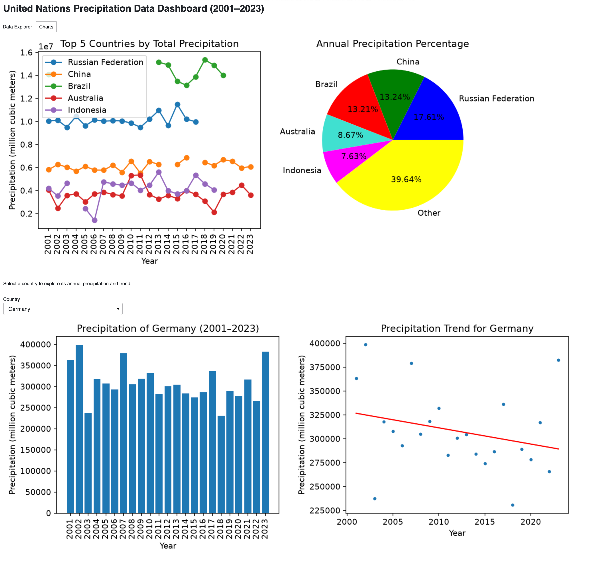

<a name="top"></a>

In this task, you update `app.py` to replace the Charts tab placeholder with an interactive layout combining static top-5 overview charts with country-specific reactive visualizations.

Follow these steps to wire up the Charts tab:

1. Copy and paste the following prompt into Bob's chat panel:

   ### What this prompt does
   With the chart functions built, you now assemble them into the Charts tab. With this prompt, IBM Bob replaces the placeholder in the second tab with a fully interactive layout combining static top-5 overview charts with a country selector that drives two reactive, country-specific visualizations.

   ### How it works
   Panel's `pn.bind` links the country dropdown widget to the bar chart and trend chart functions so they re-render automatically each time the user selects a different country. The dataset is loaded once at module level in `app.py` and shared across all charts to avoid redundant file reads.

   ```text
   The previous phases created `app.py`, `data.py`, `explorer.py`, and `charts.py`. In this phase, build the Charts tab and wire it into the app.

   Update `app.py` to replace the "Charts coming soon." placeholder with a fully interactive Charts tab. Make the following changes:

   1. Add `import data` and `import charts` to the imports (keep the existing `import explorer`).

   2. Load the data once at module level by calling `data.load_data()` and storing the result in a variable called `df`. Do not reload the CSV inside any function.

   3. Generate the top-5 line chart and pie chart once by calling `charts.line_chart_top5(df)` and `charts.pie_chart_top5(df)`. These do not need to be bound to any widget.

   4. Create a dropdown widget using `pn.widgets.Select` with:
      - name set to "Country"
      - options set to the list returned by `data.get_countries()`
      - value set to "Germany" as the default selection

   5. Use `pn.bind` to make the bar chart and trend chart reactive:
      - Bind `charts.bar_chart_country` to the `df` variable and the dropdown widget so it re-renders whenever a new country is selected.
      - Bind `charts.trend_chart_country` the same way.

   6. Assemble the Charts tab content as a `pn.Column` in this order:
      - A `pn.Row` with the top-5 line chart on the left and the top-5 pie chart on the right, with `sizing_mode="stretch_width"` on the row so both charts share the available width equally
      - A Markdown subtitle: "Select a country to explore its annual precipitation and trend."
      - The country dropdown widget
      - A `pn.Row` with the reactive bar chart on the left and the reactive trend chart on the right, also with `sizing_mode="stretch_width"`

   7. Replace the Charts placeholder `pn.pane.Markdown` in the `pn.Tabs` definition with this new Charts column.

   After making these changes, verify by running:
     python -c "import app"

   This should be complete silently.
   ```

1. To confirm permission to complete the tasks, click **Approve once** when prompted by Bob, and follow the prompts.

### What Bob does

Bob updates `app.py` with the following changes:

- Loads the dataset once at top-level.
- Generates static top-level overview charts (Top-5 Line Chart and Top-5 Pie Chart).
- Creates a country selector dropdown widget populated with all 125 country names.
- Uses `pn.bind` to wire the single-country bar chart and trend chart dynamically to the dropdown.
- Assembles the tab in a two-tier row structure with `sizing_mode="stretch_width"`.
- Replaces the Charts placeholder in `pn.Tabs`.

### Explore the application

1. Refresh or view your browser window.

1. Navigate to the **Charts** tab:
   - Notice the top static row showing the top-5 line chart and pie chart.
   - Use the **Country** dropdown to select different countries (such as `Germany`, `Chile`, or `France`).
   - Observe how the bottom bar chart and red linear regression trend chart instantly update.

The following image shows the interactive Charts tab:

<kbd></kbd>

[Back to the top](#top)
