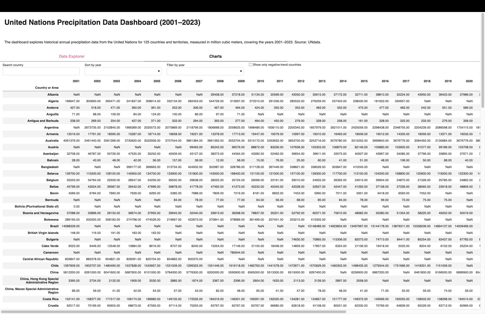
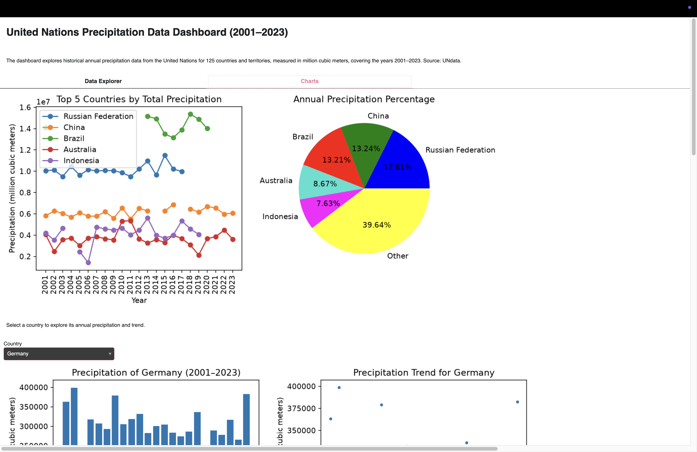

<a name="top"></a>

In this task, you apply visual styling and layout enhancements to `app.py`, giving the dashboard a polished presentation appearance.

Follow these steps to apply the final styling:

1. Copy and paste the following prompt into Bob's chat panel:

   ### What this prompt does
   The dashboard is fully functional, but a professional visual presentation makes it more credible and easier to use. With this prompt, IBM Bob applies a consistent design theme, wider tab headers, a descriptive subtitle, and alternating colors to make the table more readable; so the final product looks polished and is ready to share.

   ### How it works
   Panel's `design="fast"` theme activates a modern stylesheet, and the `raw_css` parameter injects custom CSS rules that override specific tab header and data table styles. Setting `sizing_mode="stretch_width"` on the top-level containers ensures the layout scales to fill any browser window width.

   ```text
   The dashboard is functionally complete. In this phase, make final stylistic improvements to app.py (and explorer.py where noted) to polish the presentation.

   Apply the following changes:

   Configure pn.extension(design="fast") (or design="material") and inject custom styling via raw_css.

   Style the tab headers using the following CSS rules:

   Make the outer header bar and wrapper span full width: .bk-header, .bk-headers-wrapper { width: 100% !important; display: flex !important; }
   Style each individual tab (.bk-tab) to occupy 25% of the page width with centered text, larger font, bold weight, and custom padding. Settings for .bk-tab are: width: 25% !important; text-align: center !important; font-size: 1.1em !important; font-weight: bold !important; padding: 10px 0 !important; justify-content: center !important; display: flex !important; align-items: center !important; box-sizing: border-box !important;
   Add sizing_mode="stretch_width" to both the pn.Tabs and the top-level pn.Column so the layout and tab header fill the browser window horizontally.

   Add a Markdown subtitle below the page title heading and above the pn.Tabs:
   "The dashboard explores historical annual precipitation data from the United Nations for 125 countries and territories, measured in million cubic meters, covering the years 2001–2023. Source: UNdata."

   Set a min_height=400 on each pn.Row containing charts, so rows do not collapse when charts are loading.

   Fix the table colors on the Data Explorer tab. With the fast design, the pn.pane.DataFrame table in explorer.py shows unreadable text: dark text on a dark grey background and white text on a white background. This happens because Panel's default .panel-df row colors depend on theme variables. Fix it by passing a CSS string through stylesheets=[...] on the pn.pane.DataFrame, using explicit colors:

   Text color #1f2328 on all header and body rows.
   Header row background #ffffff.
   Odd body rows #f0f2f5 and even body rows #ffffff.
   Hover row background #e1f5fe.
   Use !important on every rule so the theme variables cannot override them.
   
   After making these changes, verify by running:
   python -c "import app"
   ```

1. To confirm permission to complete the tasks, click **Approve once** when prompted by Bob, and follow the prompts.

### What Bob does

Bob updates `app.py` to apply presentation styling:

- Configures `pn.extension(design="fast")` with custom `raw_css` rules for prominent, bold tab headers and makes the "Data Explorer" and "Charts" tab titles display half the width of the screen (each tab is half the width).
- Applies `sizing_mode="stretch_width"` to the top-level container for a responsive, full-width layout.
- Inserts a descriptive subtitle detailing data sources and measurement units.
- Sets `min_height=400` on chart container rows to prevent layout shifting during renders.

### Explore the completed application

1. Switch to your browser window to view the final application.

1. Test the full application:
   - Verify the modern theme, enlarged bold tabs, and clean subtitle at the top of the page.
   - Switch between **Data Explorer** and **Charts** tabs.
   - Test filters, sorting, search, and country trend analysis.

The following image shows the completed Data Explorer tab:

<kbd></kbd>

The following image shows the completed Charts tab:

<kbd></kbd>

**Note:** When you are done exploring, switch to your terminal window and press `CTRL+C` to stop the Panel server.

[Back to the top](#top)
