## Lab overview

Turn raw global environmental data into an interactive, multi-view web dashboard — without manual coding. Learn how to use Generative AI with Python, Panel (HoloViz), pandas, and Matplotlib to build an interactive precipitation data dashboard that explores historical annual precipitation reported to the United Nations for 125 countries and territories across a 23-year period (2001–2023). Along the way, you'll collaborate with IBM Bob step by step, gaining hands-on experience with AI-assisted software modularization, reactive UI widgets, statistical slope modeling, and tabbed dashboard development.

In this lab, you build a modular Python web application that parses historical UN data, calculates derived totals and climate trends using linear regression, provides an interactive data table with mutual-exclusion filtering, and renders multi-chart visual analytics in a polished tabbed interface.


***

### Learning objectives

After completing this lab, you should be able to:

- Build a multi-module interactive data dashboard using natural-language prompts in IBM Bob.
- Follow an AI-assisted development workflow to architect, scaffold, and refine modular Python applications.
- Calculate derived metrics and linear trend slopes using `pandas` and `numpy.polyfit`.
- Create reactive user interface widgets with HoloViz `Panel` and link them to dynamic data tables and Matplotlib plots.
- Implement mutual-exclusion UI logic and data filters to isolate positive and negative precipitation trends.

***

### About this lab

In this lab, you build an interactive data dashboard to explore historical annual precipitation data from the United Nations. The dataset covers 125 countries and territories between 2001 and 2023, measured in million cubic meters. The following chart shows the flow for this application: 

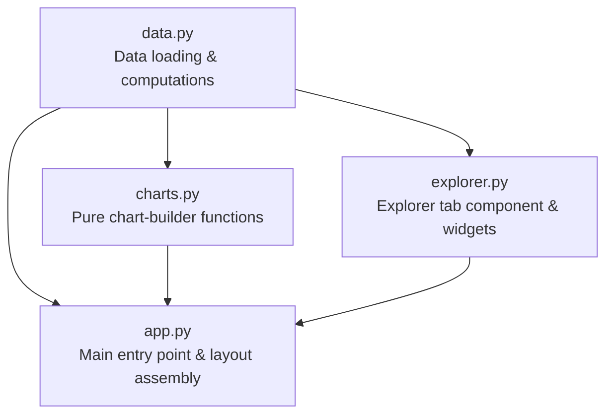

The application is structured into four clean modules (`data.py`, `charts.py`, `explorer.py`, and `app.py`) and features a two-tab interface:

- **Data Explorer Tab:**
  - An interactive, reactive data table with country search and numeric formatting.
  - Sorting and column-filtering controls with mutual-exclusion logic.
  - A toggle to filter the 61 countries exhibiting a negative precipitation trend.
  - A summary statistics sidebar surfacing key dataset findings and ranked top-5 totals.
- **Charts Tab:**
  - Top-5 multi-line chart comparing precipitation trends over time.
  - Top-5 percentage share pie chart with an aggregate "Other" slice.
  - A dynamic country selector dropdown.
  - A reactive single-country annual precipitation bar chart.
  - A reactive single-country trend scatter plot with an overlay of a red linear best-fit line.

Throughout the lab, you'll guide IBM Bob with clear instructions and specific requirements. IBM Bob will handle the coding and architecture, letting you focus on data insights and application requirements.

**Note:** Bob dynamically responds to prompts; therefore, your application may look slightly different from the screen images shown in this lab. Prompt Bob to make additional changes based on your preferences for features and styling.

***

### About the dataset

This lab uses historical annual precipitation data (`Precipitation-2023.csv`) published by the <a href="https://data.un.org/" target="_blank"> United Nations Statistics Division - UNdata</a>. **Tip:** Right-click the link, and open the page in a new tab.

The columns in the dataset include:
- **Country or Area:** Name of the country or territory (125 total).
- **2001 to 2023:** Annual precipitation measurements in million cubic meters (values of `0.0` represent missing data).

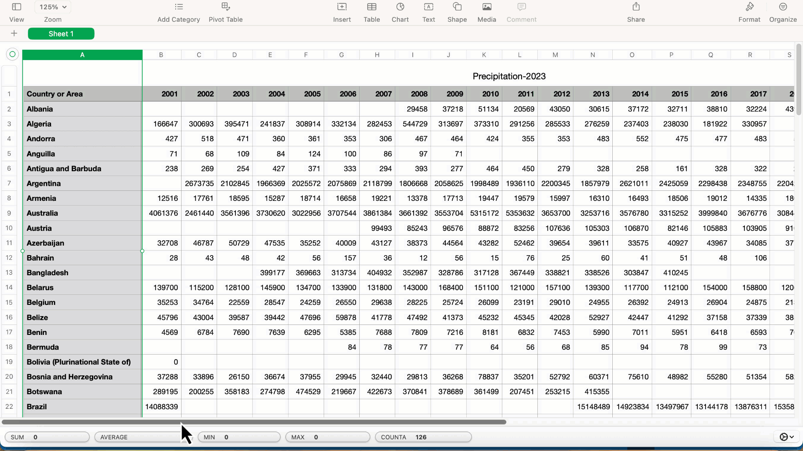
***

### Estimated time

**60 minutes**

***

### Prerequisites

**Tip:** Right-click the following link, and open the pages in a new tab.

Complete the prerequisite tasks of <a href="../../ai-in-sports/get-started-with-ibm-bob.md" target="_blank">Get started with IBM Bob</a>.

***

<a name="top"></a>

## Contents

- [Task 1: Set up the project](#task01)
- [Task 2: Create the shell application](#task02)
- [Task 3: Build the data module](#task03)
- [Task 4: Build the Data Explorer tab](#task04)
- [Task 5: Build the charts module](#task05)
- [Task 6: Assemble the Charts tab](#task06)
- [Task 7: Apply final styling and polish](#task07)
- [Summary](#summary)
- [Additional resources](#additional-resources)

***

### Preview the tutorial

Watch the following video to see a preview of the steps in this tutorial.

**Note:** Some user interface elements in the video might look different from your IBM Bob environment.

**Tip:** Right-click the following thumbnail image, and open the video in a new tab.

<a href="https://video.ibm.com/embed/channel/23669513/video/ai-in-data-precipitation">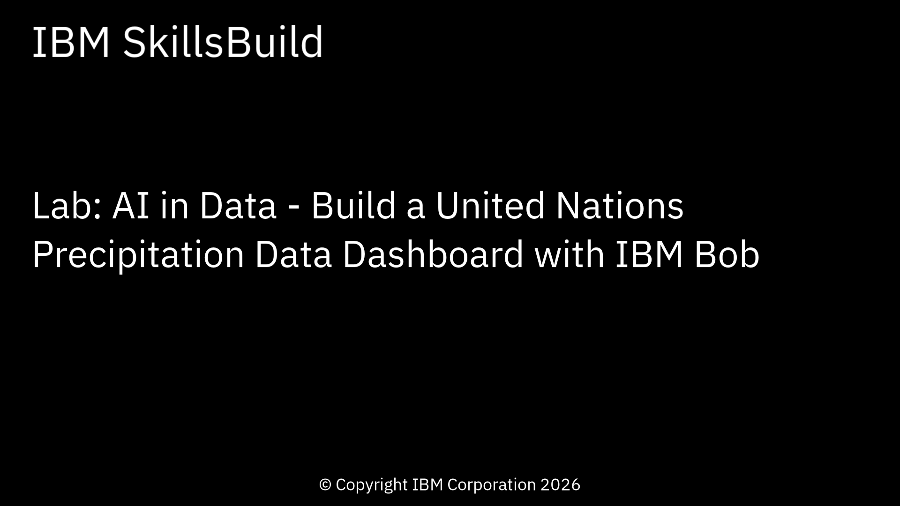</a>

***

<a name="task01"></a>

## Task 1: Set up the project

In this task, you will set up the project:

- Create a project folder and place the `Precipitation-2023.csv` data file in it.
- Verify and install the following core Python libraries:
  - **Python** - A versatile, high-level programming language used extensively in data science, web development, and AI.
  - **Panel (HoloViz)** - A high-level app and dashboarding framework for Python that turns data analysis into reactive web dashboards and multi-tab applications.
  - **pandas** - A foundational library for data manipulation and analysis, providing DataFrames for indexing, aggregating, and filtering tabular datasets.
  - **NumPy** - A fundamental package for scientific computing in Python, used in this lab for linear regression and polynomial fitting (`polyfit`).
  - **Matplotlib** - A comprehensive library for creating static, animated, and interactive visualizations in Python.

Don't worry if you don't have these packages installed yet — IBM Bob will help you check and install them in an isolated virtual environment!

### Task 1a: Set up the project folder and data

Follow these steps to create the lab directory and save the dataset:

1. In Bob, open the terminal window: click **Terminal > New Terminal**.
1. Choose a folder for the project, and `cd` into that folder.
1. Create a dedicated directory for your project:

   ```bash
   mkdir ai-in-data-precipitation
   cd ai-in-data-precipitation
   ```

1. Download <a href="Precipitation-2023.csv" target="_blank">Precipitation-2023.csv</a> from the GitHub repository, and store the file in the `ai-in-data-precipitation` folder. **Tip:** Right-click the link, and open the page in a new tab.

1. Open the project folder in IBM Bob:
   1. Click **File > Open Folder**.
   2. Navigate to the **ai-in-data-precipitation** folder.
   3. Click **Open**.

*Results:* The project folder `ai-in-data-precipitation` contains `Precipitation-2023.csv` at its root.

### Task 1b: Set up the environment

Follow these steps to install the required tools using IBM Bob:

1. In the Bob chat side panel, select **Agent** mode.

   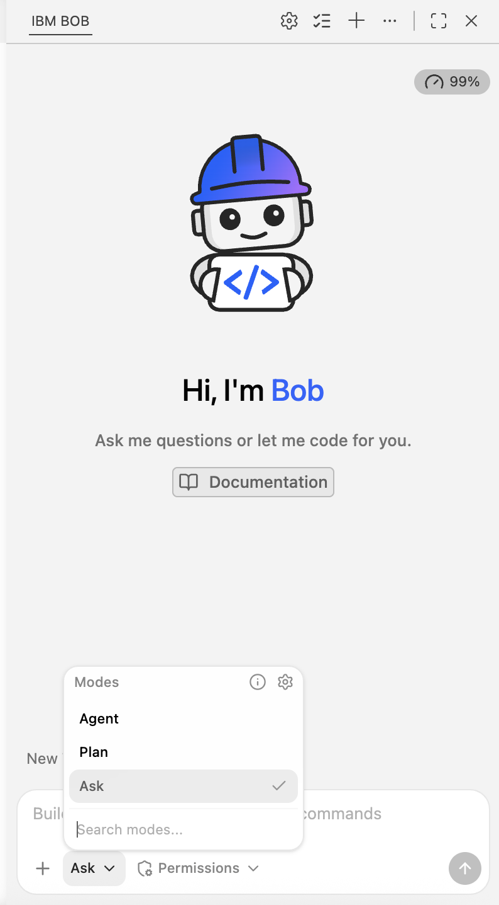

1. In the Bob chat panel, copy and paste the following prompt:

   ### What this prompt does
   Before you build the solution, you need a working Python environment with the correct libraries and folder structure. With this prompt, IBM Bob creates the project configuration files, installs the required dependencies into an isolated virtual environment, and confirms the source data file is in place.

   ### How it works
   Python's built-in `venv` module creates a project-local environment so dependencies do not conflict with other projects. Bob installs the libraries into that environment and runs an import test to prove all packages load cleanly before any application code is written.

   ```text
   I need help setting up a Python project to build an interactive precipitation data dashboard.

   Create the following in the current working directory:

   1. A `requirements.txt` file listing these four packages, one per line, with no pinned versions:
      panel
      pandas
      numpy
      matplotlib

   2. A `.gitignore` file that ignores the `.venv/` directory.

   Then run the following shell commands in order:
   - `python --version` — confirm Python 3.9 or higher is installed.
   - `python -m venv .venv` — create a virtual environment in the project root.
   - `source .venv/bin/activate` — activate the environment (macOS/Linux). On Windows use `.venv\Scripts\activate`.
   - `pip install -r requirements.txt` — install all dependencies.
   - `python -c "import pandas, numpy, matplotlib, panel; print('OK')"` — verify all packages import cleanly.

   Finally, confirm that `Precipitation-2023.csv` is present in the project root. This file is the data source for the entire project and must not be moved or renamed.

   Do not create any Python source files yet. This phase is complete when the verification command prints `OK` and `Precipitation-2023.csv` is confirmed present.
   ```

1. To confirm permission to complete the tasks, click **Approve once** when prompted by Bob, and follow the prompts.

### What Bob does

Bob completes the following tasks based on the prompt:

- Creates a `requirements.txt` file specifying `panel`, `pandas`, `numpy`, and `matplotlib`.
- Creates a `.gitignore` file configured to ignore the `.venv/` folder.
- Creates and activates a project-local virtual environment (`.venv`).
- Installs all dependencies and executes an import test to confirm they load cleanly.
- Verifies that `Precipitation-2023.csv` exists in the project root.

The following image shows the verified project setup:

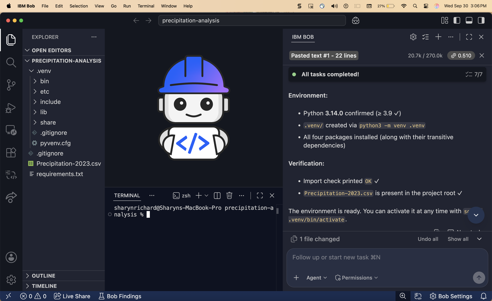

[Back to the top](#top)

***

<a name="task02"></a>

## Task 2: Create the shell application

In this task, you create the main application entry point (`app.py`). It establishes the initial page structure with a main title and two tabs ("Data Explorer" and "Charts") containing placeholder content, establishing a runnable application shell for all subsequent modules.

Follow these steps to build the application shell:

1. Copy and paste the following prompt into Bob's chat panel:

   ### What this prompt does
   Before adding data or charts, you establish a runnable application frame. With this prompt, IBM Bob creates the main entry point that defines the page layout, tab structure, and the title that users will see every time the dashboard loads.

   ### How it works
   Panel's `pn.Tabs` component provides the two-tab shell, and calling `.servable()` on the top-level layout registers it with the Panel server so it can be served immediately in a browser. This gives you a live, working application skeleton from the very first run.

   ```text
   In this phase, create `app.py` in the project root. This is the shell of the dashboard — it should serve immediately and show the page structure, but the tabs will contain placeholder text for now. Content will be added in later phases.

   Build the file as follows:

   1. Import `panel as pn`.

   2. Call `pn.extension()` near the top of the file to initialise Panel.

   3. Create two placeholder tab contents:
      - A `pn.pane.Markdown` with the text "Data Explorer coming soon." for the Data Explorer tab.
      - A `pn.pane.Markdown` with the text "Charts coming soon." for the Charts tab.

   4. Build a `pn.Tabs` layout with two tabs:
      - ("Data Explorer", the Data Explorer placeholder)
      - ("Charts", the Charts placeholder)

   5. Wrap the `pn.Tabs` in a `pn.Column` containing:
      - A Markdown heading: "# United Nations Precipitation Data Dashboard (2001–2023)" as the first element
      - The `pn.Tabs` as the second element

   6. Call `.servable()` on the top-level `pn.Column`.

   After writing the file, check for syntax errors by running:
     python -c "import app"

   This should be complete silently with no errors.
   ```

1. To confirm permission to complete the tasks, click **Approve once** when prompted by Bob, and follow the prompts.

### What Bob does

Bob completes the following tasks based on the prompt:

- Imports `panel as pn` and initializes Panel with `pn.extension()`.
- Creates placeholder Markdown panes for both the Data Explorer and Charts views.
- Builds a `pn.Tabs` layout containing the two tab views.
- Assembles a top-level `pn.Column` with the main dashboard header and calls `.servable()`.
- Verifies that `import app` executes without errors.

### Explore the application

1. In the terminal window, start the Panel development server:

   ```bash
   panel serve app.py --show --autoreload
   ```

1. A browser window will open to the served dashboard URL (typically `http://localhost:5006/app`).

1. Explore the application shell:
   - Notice the main header: *United Nations Precipitation Data Dashboard (2001–2023)*.
   - Click between the **Data Explorer** and **Charts** tabs to verify that both placeholder messages appear.

The following image shows the running application shell:

<kbd>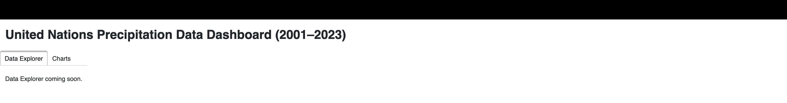</kbd>

[Back to the top](#top)

***

<a name="task03"></a>

## Task 3: Build the data module

In this task, you prompt Bob to create `data.py` to centralize all data loading, row-wise aggregation, linear trend slope computation, and summary helper functions so that UI components never perform raw CSV parsing.

Follow these steps to build the data processing module:

1. Copy and paste the following prompt into Bob's chat panel:

   ### What this prompt does
   You need the raw CSV data loaded, enriched, and available to every other module before you can build the UI. With this prompt, IBM Bob creates the centralized data layer that all tabs and charts will import, so data processing logic lives in one place and is never duplicated.

   ### How it works
   pandas reads the CSV into a DataFrame and indexes it by country name. NumPy's `polyfit` function calculates a linear regression slope for each country's precipitation values over time, treating years with a value of `0.0` as missing data to keep the trend calculation accurate.

   ```text
   In this phase, create `data.py` in the project root.

   The data comes from `Precipitation-2023.csv`, which contains historical annual precipitation measurements 
   (in million cubic meters) reported to the United Nations. It has 125 rows — one per country or territory — 
   and 24 columns: "Country or Area" plus one column for each of these years: 2001, 2002, 2003, 2004, 2005, 
   2006, 2007, 2008, 2009, 2010, 2011, 2012, 2013, 2014, 2015, 2016, 2017, 2018, 2019, 2020, 2021, 2022, 2023.
   Values of 0.0 in the year columns represent missing data, not actual zero precipitation.

   `data.py` must contain the following:

   1. A function `load_data(path="Precipitation-2023.csv")` that:
      - Reads the CSV into a pandas DataFrame using `pandas.read_csv`.
      - Sets the "Country or Area" column as the DataFrame index and removes it from the data columns.
      - Computes a "SUM" column containing the row-wise total across all 23 year columns only (use 
        `df[year_cols].sum(axis=1)` so that derived columns added later are not included).
      - Computes a "TREND" column using a helper function called `compute_slope`. For each row, `compute_slope` should:
        - Filter the row to only include year columns where the value is greater than 0.0 (excluding missing data).
        - If fewer than 2 valid values remain, return `numpy.nan`.
        - Otherwise, call `numpy.polyfit` with the years cast to integers as x-values and the precipitation 
          values as y-values, using degree 1, and return the slope (the first element of the result).
      - Returns the fully enriched DataFrame.

   2. A function `get_years()` that returns this exact list of year column names as strings:
      ['2001','2002','2003','2004','2005','2006','2007','2008','2009','2010','2011','2012','2013','2014','2015',
      '2016','2017','2018','2019','2020','2021','2022','2023']

   3. A function `get_countries()` that calls `load_data()` and returns a sorted list of all country and territory 
   names from the DataFrame index.

   4. A function `get_negative_trend_countries()` that calls `load_data()` and returns a sorted list of country 
   names where the TREND value is less than 0.0.

   5. A function `get_top5_countries()` that calls `load_data()` and returns a list of the 5 country names with 
   the highest SUM values, ordered from highest to lowest.

   After writing the file, verify it works by running:
     python -c "
     import data
     df = data.load_data()
     print(df.shape)
     print(df[['SUM','TREND']].head())
     print('Negative trend count:', len(data.get_negative_trend_countries()))
     print('Top 5:', data.get_top5_countries())
     "

   The output should show a shape of (125, 25), SUM and TREND values for the first five countries, a negative trend 
   count of 61, and a top-5 list.
   ```

1. To confirm permission to complete the tasks, click **Approve once** when prompted by Bob, and follow the prompts.

### What Bob does

Bob creates `data.py` with the following functionality:

- `load_data()` loads `Precipitation-2023.csv`, indexes by `Country or Area`, calculates row-wise 23-year totals (`SUM`), and derives linear trend slopes (`TREND`) via `numpy.polyfit` while ignoring `0.0` missing data values.
- `get_years()` returns the 23 year column labels as an ordered list.
- `get_countries()` returns an alphabetical list of all 125 country and territory names.
- `get_negative_trend_countries()` returns all 61 countries exhibiting a negative slope (`TREND < 0.0`).
- `get_top5_countries()` identifies and ranks the top-5 countries by total 23-year volume (starting with Russian Federation).

### Verify the results

1. Check Bob's terminal output from the verification script. Confirm that:
   - The DataFrame shape is `(125, 25)` (23 year columns + `SUM` + `TREND`).
   - The negative trend count equals `61`.
   - The top-5 list outputs: `['Russian Federation', 'China', 'Brazil', 'Australia', 'Indonesia']`.

The following image shows the verified data module output:

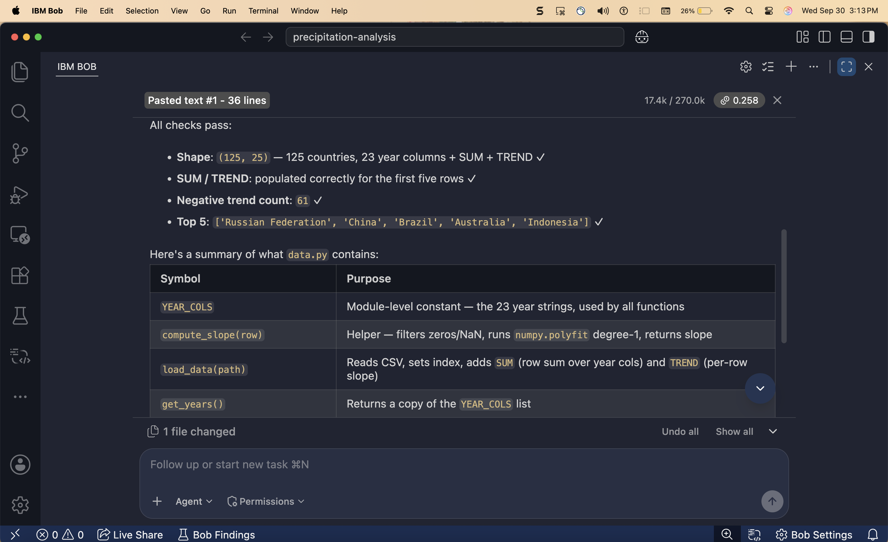

[Back to the top](#top)

***

<a name="task04"></a>

## Task 4: Build the Data Explorer tab

In this task, you build `explorer.py` to create the Data Explorer tab component. It features an interactive, reactive data table with country search, year-based sorting and filtering with mutual exclusion, negative-trend filtering, and a dataset statistics sidebar. You will then wire `explorer_tab` into `app.py`.

Follow these steps to create and integrate the Data Explorer tab:

1. Copy and paste the following prompt into Bob's chat panel:

   ### What this prompt does
   With the data module in place, you now build the first interactive tab that lets users browse and filter the full dataset. With this prompt, IBM Bob creates the content for the Data Explorer tab, complete with reactive search, sorting, column filtering, and a statistics sidebar, then wires it directly into the running application.

   ### How it works
   Panel's `pn.bind` function connects each widget to the data table so the display updates automatically whenever a user changes a filter or search value. Mutual-exclusion callbacks ensure the sort and filter dropdowns cannot conflict with each other, keeping the user interface predictable and consistent.

   ```text
   The previous phases created `app.py` and `data.py`. In this phase, build the Data Explorer tab and wire it into the app.

   This tab lets users interactively browse all 125 countries in a filterable data table, alongside a static statistics sidebar that surfaces key findings from the data analysis.

   Step 1 — Create `explorer.py` in the project root.

   `explorer.py` must build and expose a single Panel object called `explorer_tab` that represents the full content of the Data Explorer tab. Build it as follows:

   1. Import `panel as pn`, then import `data` from the local module.

   2. Load the data once at module level: `df = data.load_data()`.

   3. Define a function `data_table(country_search, sort_year, year_filter, negative_only)` inside `explorer.py`:
      - `country_search` is a string. Filter rows where the index (country name) contains this value (case-insensitive). Skip the filter if the string is empty.
      - `year_filter` is a string. If it is not empty, keep only that year column plus SUM and TREND in the displayed table; if empty, show all columns.
      - `negative_only` is a boolean. When True, filter the DataFrame to only include rows where TREND < 0.0.
      - `sort_year` is a string. If it is not empty, sort the resulting DataFrame by that year column in descending order.
      - Return a `pn.pane.DataFrame` pane showing the filtered/sorted DataFrame, with numeric columns formatted to 2 decimal places using the `float_format` parameter.

   4. Create a country search field using `pn.widgets.TextInput` with:
      - name set to "Search country"
      - value set to "" (empty by default)

   5. Create a sort by year dropdown using `pn.widgets.Select` with:
      - name set to "Sort by year"
      - options set to a list containing an empty string "" (meaning "no sort") followed by all year column names from `data.get_years()`
      - value set to "" (no sort by default)

   6. Create a year filter dropdown using `pn.widgets.Select` with:
      - name set to "Filter by year"
      - options set to a list containing an empty string "" (meaning "all years") followed by all year column names from `data.get_years()`
      - value set to "" (show all years by default)

   7. Wire up mutual exclusion between the two year dropdowns so that selecting a year in one disables the other:
      - Define a function `update_filter_disabled(sort_val)` that sets `year_filter_widget.disabled = (sort_val != "")`. Bind it to the sort-by-year widget using `pn.bind`.
      - Define a function `update_sort_disabled(filter_val)` that sets `sort_year_widget.disabled = (filter_val != "")`. Bind it to the year-filter widget using `pn.bind`.
      - Both functions must return `None` (they are side-effect-only watchers, not reactive components added to the layout).

   8. Create a filter checkbox using `pn.widgets.Checkbox` with:
      - name set to "Show only negative-trend countries"
      - value set to False

   9. Use `pn.bind` to wire `data_table` to all four widgets (country search, sort by year, year filter, and the checkbox) so the table re-renders whenever any widget changes.

   10. Build a statistics sidebar as a `pn.pane.Markdown` pane. Compute these values once at module level from `data.get_negative_trend_countries()` and `data.get_top5_countries()`, and format them into a Markdown string with these sections:
       - "## Dataset Summary"
       - "**Total countries:** 91"
       - "**Countries with negative precipitation trend:** {count}"
       - "## Top 5 Countries by Total Precipitation" followed by a numbered list of the 5 country names

   11. Assemble the tab content as a `pn.Column` containing:
       - A Markdown heading: "## Data Explorer"
       - A `pn.Row` with the country search field, the sort by year dropdown, the year filter dropdown, and the filter checkbox
       - A `pn.Row` with the reactive data table on the left and the statistics sidebar on the right

   12. Assign this `pn.Column` to a module-level variable called `explorer_tab`.

   Step 2 — Update `app.py` to use `explorer_tab`.

   Replace the "Data Explorer coming soon." placeholder in `app.py` with `explorer.explorer_tab`:
   1. Add `import explorer` to the imports in `app.py`.
   2. Replace the Data Explorer placeholder `pn.pane.Markdown` with `explorer.explorer_tab` in the `pn.Tabs` definition.

   After making both changes, verify by running:
     python -c "import app"

   This should be complete silently.
   ```

1. To confirm permission to complete the tasks, click **Approve once** when prompted by Bob, and follow the prompts.

### What Bob does

Bob completes the following tasks based on the prompt:

- Creates `explorer.py` with input widgets for search, sort, column filtering, and negative-trend filtering.
- Implements mutual-exclusion callbacks so choosing a sort year disables column filtering, and vice versa.
- Creates a reactive `pn.pane.DataFrame` linked to all controls via `pn.bind`.
- Assembles a static markdown statistics panel with dataset totals and top-5 rankings.
- Updates `app.py` to import `explorer` and embed `explorer.explorer_tab` into the first tab of `pn.Tabs`.

### Explore the application

1. Switch back to your browser (the autoreload server updates automatically).

1. Explore the **Data Explorer** tab:
   - Type a country name (such as `Chile` or `United`) into **Search country** to verify real-time filtering.
   - Select a year in **Sort by year** (e.g., `2005`) and observe that the table re-orders by that column and **Filter by year** becomes disabled. Clear the selection to re-enable both.
   - Select a year in **Filter by year** (e.g., `2008`) and observe that other annual columns hide while **Sort by year** is disabled.
   - Check **Show only negative-trend countries** to isolate the 61 countries with negative slope values.
   - Review the **Dataset Summary** and **Top 5 Countries by Total Precipitation** in the statistics sidebar.

The following image shows the interactive Data Explorer tab:

<kbd>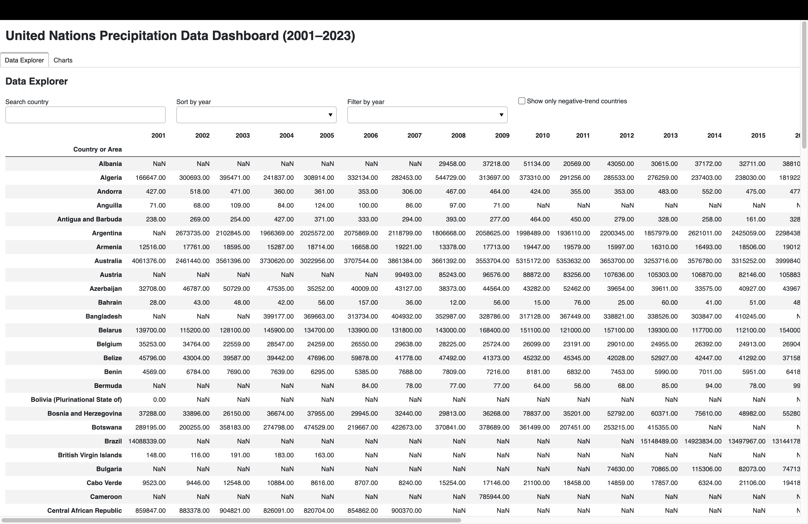</kbd>

[Back to the top](#top)

***

<a name="task05"></a>

## Task 5: Build the charts module

In this task, you prompt Bob to create `charts.py` containing pure chart-generating functions using Matplotlib and Panel. Each function creates an isolated, properly sized figure, wraps it in a `pn.pane.Matplotlib` object, and manages memory cleanly.

Follow these steps to build the charts module:

1. Copy and paste the following prompt into Bob's chat panel:

   ### What this prompt does
   The Data Explorer tab provides tables and filters, but charts reveal patterns that numbers alone can miss. With this prompt, IBM Bob builds a dedicated chart library of four pure functions — each producing a self-contained, properly sized visualization ready to be dropped into the Charts tab.

   ### How it works
   Matplotlib generates each figure in isolation, and Panel's `pn.pane.Matplotlib` wrapper makes each figure renderable inside the dashboard. Calling `plt.close(fig)` after each wrap prevents figures from accumulating in memory as users interact with country dropdowns and filters.

   ```text
   The previous phases created `app.py`, `data.py`, and `explorer.py`. In this phase, create `charts.py` in the project root.

   `charts.py` builds all four charts used in the dashboard. Each chart function must:
   - Create a new matplotlib figure using `fig, ax = plt.subplots(figsize=(5, 4))` so figures are fully isolated from each other and sized to fit side-by-side within the browser window without horizontal scrolling.
   - Wrap the figure in a `panel.pane.Matplotlib` object and return it.
   - Call `plt.close(fig)` after wrapping so figures do not accumulate in memory.

   Implement these four functions:

   1. `bar_chart_country(df, country)`
      - Looks up the row for the given country in the DataFrame.
      - Uses only the 23 year columns (not SUM or TREND).
      - Plots a bar chart showing annual precipitation for that country across all available years.
      - Sets the x-axis tick labels to the year names, rotated 90 degrees.
      - Title: "Precipitation of {country} (2001–2023)"
      - X-axis label: "Year"
      - Y-axis label: "Precipitation (million cubic meters)"

   2. `line_chart_top5(df)`
      - Finds the 5 countries with the highest total precipitation by sorting the SUM column in descending order and taking the first 5 rows.
      - Transposes the 23 year columns so that years are on the x-axis and each country is a separate line.
      - Plots each country as a line with circular markers (marker='o') and includes a legend.
      - Title: "Top 5 Countries by Total Precipitation"
      - X-axis label: "Year"
      - Y-axis label: "Precipitation (million cubic meters)"

   3. `pie_chart_top5(df)`
      - Builds a pandas Series from the SUM values of the top 5 countries (sorted by SUM descending).
      - Adds a sixth entry labelled "Other" whose value is the combined SUM of all remaining countries.
      - Plots a pie chart with percentage labels formatted to 2 decimal places (autopct="%1.2f%%").
      - Uses these slice colours in order: blue, green, red, turquoise, magenta, yellow.
      - Title: "Annual Precipitation Percentage"

   4. `trend_chart_country(df, country)`
      - Looks up the row for the given country in the DataFrame, using only the 23 year columns.
      - Filters out any 0.0 values (missing data).
      - If fewer than 2 valid data points remain, returns a `panel.pane.Str` pane with the message: "Not enough data to compute a trend for {country}."
      - Otherwise, fits a straight line through the valid data points using `numpy.polyfit` with the years as integers for the x-axis and degree 1.
      - Plots the valid data points as dots ('.') and the fitted line as a solid red line ('-').
      - Title: "Precipitation Trend for {country}"
      - X-axis label: "Year"
      - Y-axis label: "Precipitation (million cubic meters)"

   After writing the file, verify it works by running:
     python -c "
     import data, charts
     df = data.load_data()
     p = charts.bar_chart_country(df, 'Germany')
     print(type(p))
     p2 = charts.line_chart_top5(df)
     print(type(p2))
     "

   Both lines should print: <class 'panel.pane.plot.Matplotlib'>
   ```

1. To confirm permission to complete the tasks, click **Approve once** when prompted by Bob, and follow the prompts.

### What Bob does

Bob creates `charts.py` containing four charting functions:

- `bar_chart_country()`: Generates an annual bar chart for any selected country with rotated year ticks.
- `line_chart_top5()`: Plots 23-year comparative line trends with point markers and legends for the top 5 precipitation leaders.
- `pie_chart_top5()`: Calculates global percentage shares for the top 5 countries plus a combined "Other" slice with designated colors.
- `trend_chart_country()`: Plots valid non-zero data points and fits a regression line in red, returning an informative string pane when fewer than 2 valid points exist.
- Standardizes all plots with `figsize=(5, 4)` and memory cleanup via `plt.close(fig)`.

### Verify the results

1. Check the verification output in Bob's panel.
1. Confirm both test function calls return `<class 'panel.pane.plot.Matplotlib'>`.

The following image shows the verified chart module testing:

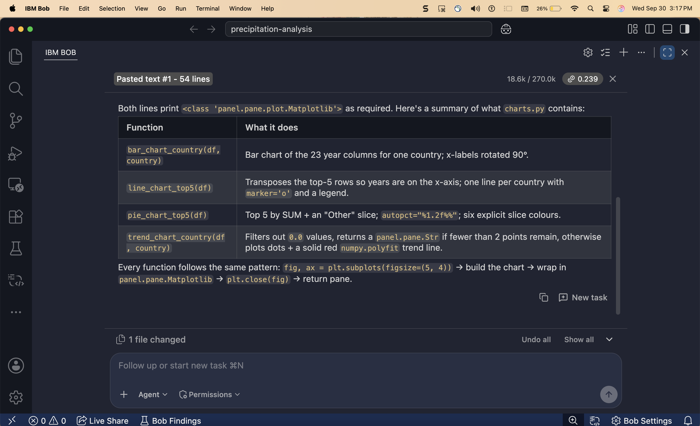

[Back to the top](#top)

***

<a name="task06"></a>

## Task 6: Assemble the Charts tab

In this task, you update `app.py` to replace the Charts tab placeholder with an interactive layout combining static top-5 overview charts with country-specific reactive visualizations.

Follow these steps to wire up the Charts tab:

1. Copy and paste the following prompt into Bob's chat panel:

   ### What this prompt does
   With the chart functions built, you now assemble them into the Charts tab. With this prompt, IBM Bob replaces the placeholder in the second tab with a fully interactive layout combining static top-5 overview charts with a country selector that drives two reactive, country-specific visualizations.

   ### How it works
   Panel's `pn.bind` links the country dropdown widget to the bar chart and trend chart functions so they re-render automatically each time the user selects a different country. The dataset is loaded once at module level in `app.py` and shared across all charts to avoid redundant file reads.

   ```text
   The previous phases created `app.py`, `data.py`, `explorer.py`, and `charts.py`. In this phase, build the Charts tab and wire it into the app.

   Update `app.py` to replace the "Charts coming soon." placeholder with a fully interactive Charts tab. Make the following changes:

   1. Add `import data` and `import charts` to the imports (keep the existing `import explorer`).

   2. Load the data once at module level by calling `data.load_data()` and storing the result in a variable called `df`. Do not reload the CSV inside any function.

   3. Generate the top-5 line chart and pie chart once by calling `charts.line_chart_top5(df)` and `charts.pie_chart_top5(df)`. These do not need to be bound to any widget.

   4. Create a dropdown widget using `pn.widgets.Select` with:
      - name set to "Country"
      - options set to the list returned by `data.get_countries()`
      - value set to "Germany" as the default selection

   5. Use `pn.bind` to make the bar chart and trend chart reactive:
      - Bind `charts.bar_chart_country` to the `df` variable and the dropdown widget so it re-renders whenever a new country is selected.
      - Bind `charts.trend_chart_country` the same way.

   6. Assemble the Charts tab content as a `pn.Column` in this order:
      - A `pn.Row` with the top-5 line chart on the left and the top-5 pie chart on the right, with `sizing_mode="stretch_width"` on the row so both charts share the available width equally
      - A Markdown subtitle: "Select a country to explore its annual precipitation and trend."
      - The country dropdown widget
      - A `pn.Row` with the reactive bar chart on the left and the reactive trend chart on the right, also with `sizing_mode="stretch_width"`

   7. Replace the Charts placeholder `pn.pane.Markdown` in the `pn.Tabs` definition with this new Charts column.

   After making these changes, verify by running:
     python -c "import app"

   This should be complete silently.
   ```

1. To confirm permission to complete the tasks, click **Approve once** when prompted by Bob, and follow the prompts.

### What Bob does

Bob updates `app.py` with the following changes:

- Loads the dataset once at top-level.
- Generates static top-level overview charts (Top-5 Line Chart and Top-5 Pie Chart).
- Creates a country selector dropdown widget populated with all 125 country names.
- Uses `pn.bind` to wire the single-country bar chart and trend chart dynamically to the dropdown.
- Assembles the tab in a two-tier row structure with `sizing_mode="stretch_width"`.
- Replaces the Charts placeholder in `pn.Tabs`.

### Explore the application

1. Refresh or view your browser window.

1. Navigate to the **Charts** tab:
   - Notice the top static row showing the top-5 line chart and pie chart.
   - Use the **Country** dropdown to select different countries (such as `Germany`, `Chile`, or `France`).
   - Observe how the bottom bar chart and red linear regression trend chart instantly update.

The following image shows the interactive Charts tab:

<kbd>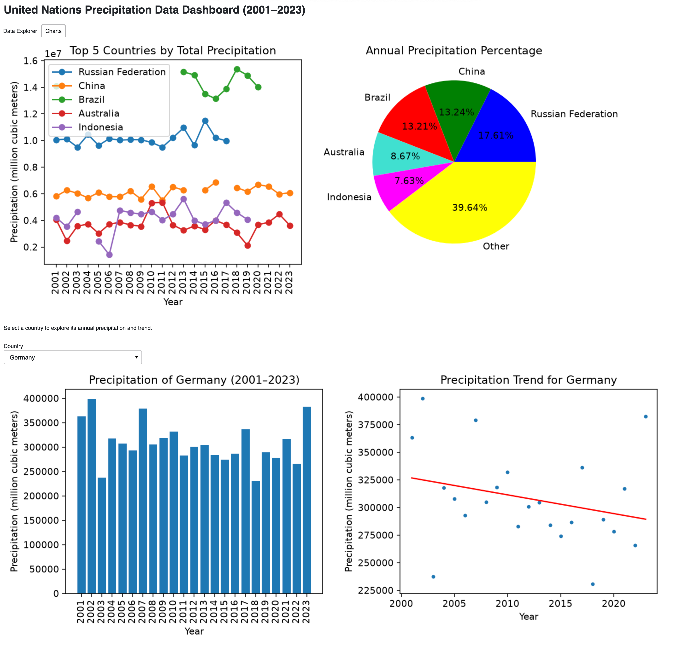</kbd>

[Back to the top](#top)

***

<a name="task07"></a>

## Task 7: Apply final styling and polish

In this task, you apply visual styling and layout enhancements to `app.py`, giving the dashboard a polished presentation appearance.

Follow these steps to apply the final styling:

1. Copy and paste the following prompt into Bob's chat panel:

   ### What this prompt does
   The dashboard is fully functional, but a professional visual presentation makes it more credible and easier to use. With this prompt, IBM Bob applies a consistent design theme, wider tab headers, a descriptive subtitle, and alternating colors to make the table more readable; so the final product looks polished and is ready to share.

   ### How it works
   Panel's `design="fast"` theme activates a modern stylesheet, and the `raw_css` parameter injects custom CSS rules that override specific tab header and data table styles. Setting `sizing_mode="stretch_width"` on the top-level containers ensures the layout scales to fill any browser window width.

   ```text
   The dashboard is functionally complete. In this phase, make final stylistic improvements to app.py (and explorer.py where noted) to polish the presentation.

   Apply the following changes:

   Configure pn.extension(design="fast") (or design="material") and inject custom styling via raw_css.

   Style the tab headers using the following CSS rules:

   Make the outer header bar and wrapper span full width: .bk-header, .bk-headers-wrapper { width: 100% !important; display: flex !important; }
   Style each individual tab (.bk-tab) to occupy 25% of the page width with centered text, larger font, bold weight, and custom padding. Settings for .bk-tab are: width: 25% !important; text-align: center !important; font-size: 1.1em !important; font-weight: bold !important; padding: 10px 0 !important; justify-content: center !important; display: flex !important; align-items: center !important; box-sizing: border-box !important;
   Add sizing_mode="stretch_width" to both the pn.Tabs and the top-level pn.Column so the layout and tab header fill the browser window horizontally.

   Add a Markdown subtitle below the page title heading and above the pn.Tabs:
   "The dashboard explores historical annual precipitation data from the United Nations for 125 countries and territories, measured in million cubic meters, covering the years 2001–2023. Source: UNdata."

   Set a min_height=400 on each pn.Row containing charts, so rows do not collapse when charts are loading.

   Fix the table colors on the Data Explorer tab. With the fast design, the pn.pane.DataFrame table in explorer.py shows unreadable text: dark text on a dark grey background and white text on a white background. This happens because Panel's default .panel-df row colors depend on theme variables. Fix it by passing a CSS string through stylesheets=[...] on the pn.pane.DataFrame, using explicit colors:

   Text color #1f2328 on all header and body rows.
   Header row background #ffffff.
   Odd body rows #f0f2f5 and even body rows #ffffff.
   Hover row background #e1f5fe.
   Use !important on every rule so the theme variables cannot override them.
   
   After making these changes, verify by running:
   python -c "import app"
   ```

1. To confirm permission to complete the tasks, click **Approve once** when prompted by Bob, and follow the prompts.

### What Bob does

Bob updates `app.py` to apply presentation styling:

- Configures `pn.extension(design="fast")` with custom `raw_css` rules for prominent, bold tab headers and makes the "Data Explorer" and "Charts" tab titles display half the width of the screen (each tab is half the width).
- Applies `sizing_mode="stretch_width"` to the top-level container for a responsive, full-width layout.
- Inserts a descriptive subtitle detailing data sources and measurement units.
- Sets `min_height=400` on chart container rows to prevent layout shifting during renders.

### Explore the completed application

1. Switch to your browser window to view the final application.

1. Test the full application:
   - Verify the modern theme, enlarged bold tabs, and clean subtitle at the top of the page.
   - Switch between **Data Explorer** and **Charts** tabs.
   - Test filters, sorting, search, and country trend analysis.

The following image shows the completed Data Explorer tab:

<kbd>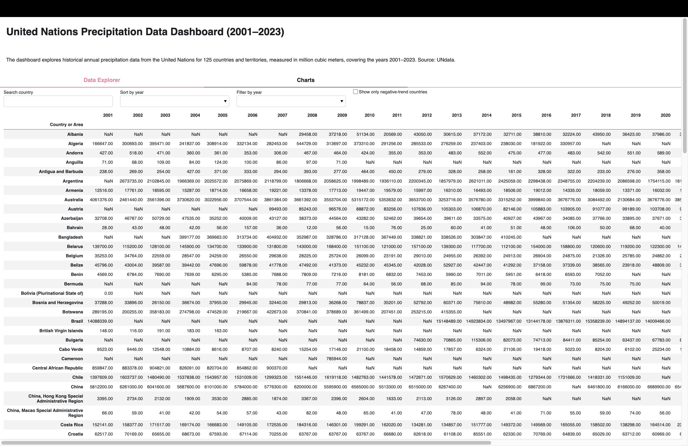</kbd>

The following image shows the completed Charts tab:

<kbd>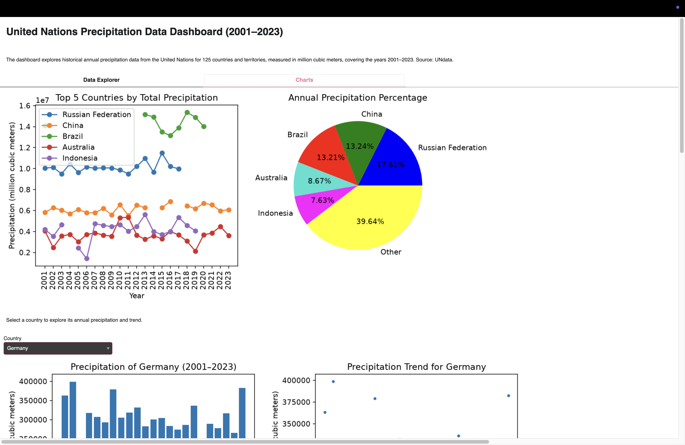</kbd>

**Note:** When you are done exploring, switch to your terminal window and press `CTRL+C` to stop the Panel server.

[Back to the top](#top)

***

<a name="summary"></a>

## Summary

In this lab, you built an interactive, modular data dashboard that explores United Nations precipitation data across 125 countries and territories. Using IBM Bob, you implemented data pre-processing, linear trend modeling, mutual-exclusion filtering, and dynamic multi-view charts without manual coding.

### What you learned

Now that you have completed this lab, you should be able to:

- Build a multi-module interactive data dashboard using natural-language prompts in IBM Bob.
- Follow an AI-assisted development workflow to architect, scaffold, and refine modular Python applications.
- Calculate derived metrics and linear trend slopes using `pandas` and `numpy.polyfit`.
- Create reactive user interface widgets with HoloViz `Panel` and link them to dynamic data tables and Matplotlib plots.
- Implement mutual-exclusion UI logic and data filters to isolate positive and negative precipitation trends.

[Back to the top](#top)

<a name="additional-resources"></a>

### Additional resources

- <a href="https://bob.ibm.com/docs" target="_blank">IBM Bob documentation</a>
- <a href="https://panel.holoviz.org/" target="_blank">Panel (HoloViz) documentation</a>
- <a href="ttps://pandas.pydata.org/docs/" target="_blank">pandas documentation</a>
- <a href="https://matplotlib.org/stable/contents.html" target="_blank">Matplotlib documentation</a>
- <a href="https://data.un.org/" target="_blank">UNdata - United Nations Statistics Division</a>
